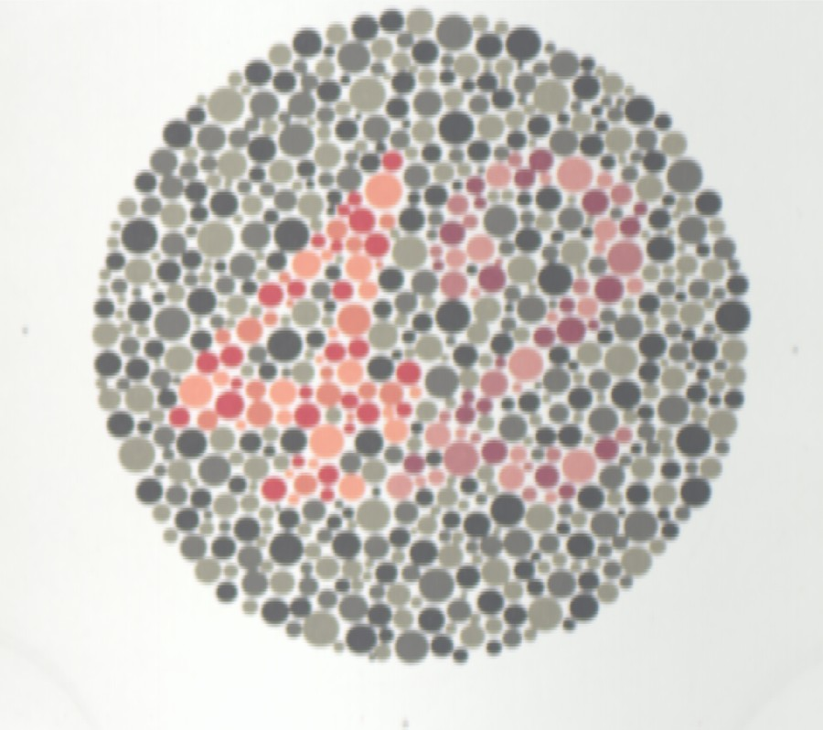
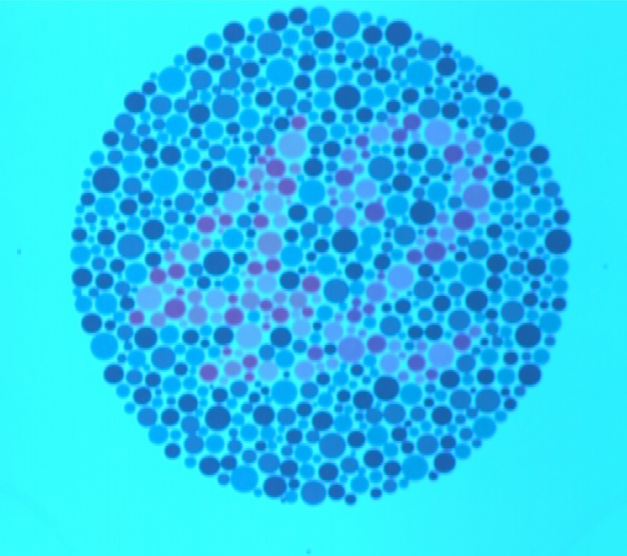
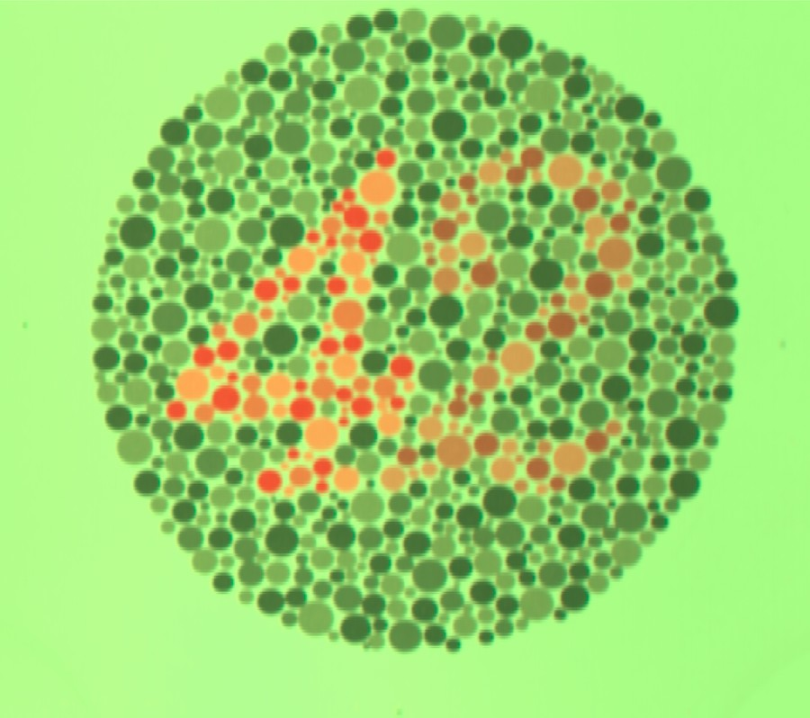
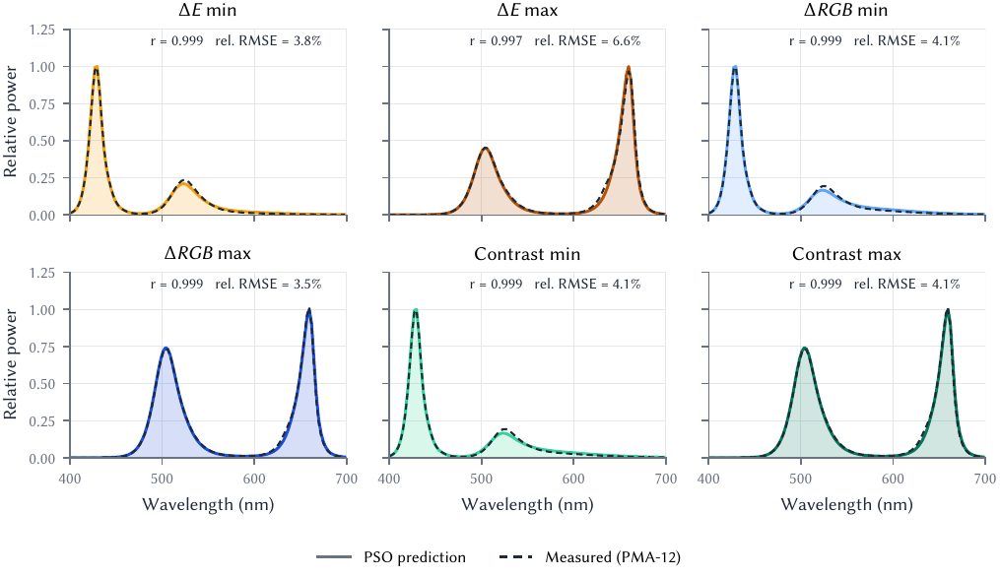

# Spectrally Optimal Light Sources

**Designing LED illumination that hides or reveals an Ishihara numeral, with particle swarm optimisation and a real tunable light source.**

Minh Khang Tran - Color Science Laboratory, University of Eastern Finland (Erasmus Mundus COSI), 2025

[Report (PDF)](report/main.pdf)

| D65 | Delta E minimised | Delta E maximised |
|:---:|:---:|:---:|
|  |  |  |
| Delta E = 31.8 | 7.5 | 57.7 |

**Figure 1.** Plate "42" rendered from its measured reflectance under D65 and under the two LED mixes PSO found for the smallest and largest CIELAB difference between numeral and background.

## Overview

An Ishihara plate works because its numeral and background dots differ mainly in the long wavelengths. With a light source whose spectrum can be set channel by channel, that can be exploited directly: **which mix of the available LEDs makes the numeral as hard, or as easy, as possible to see?**

The lab measured two dots of the plate with a Specim V10E hyperspectral camera and the ten channels of a Ledmotive Spectra Tune Lab with a Hamamatsu PMA-12 spectrometer. PSO then searched the LED mix for six objectives: minimise or maximise CIELAB Delta E\*ab, sRGB Delta RGB, and Michelson luminance contrast. The six lights were set on the Ledmotive and their emitted spectra measured again.

- Delta E between numeral and background goes from **31.8 under D65 to 7.5 (hidden) or 57.7 (revealed)**.
- Every optimum uses **at most 3 of the 10 LEDs**: 504 + 660 nm to reveal, 430 + 524/546 nm to hide.
- The reproduced lights match the predicted spectra with **Pearson r = 0.997-0.999** and **3.5-6.6% relative error**.

The match is in the emitted spectrum. The colour difference on the real plate under those lights was not measured (see Limitations).

## Method

1. **Reflectance.** `R = (S - D) / (W - D)` from the sample, white and dark scans; one pixel in a numeral dot (R1) and one in a background dot (R2); 120 bands from 400 to 700 nm.
2. **Colour under a light.** CIE 1931 XYZ with `k = 100 / sum(L * ybar)`, then CIELAB (D65 white), sRGB, and grey level `0.2125 R + 0.7154 G + 0.0721 B`. A light that pushes either dot out of the sRGB gamut is infeasible.
3. **Search.** A light is a convex mix `L = sum_j mu_j L_j` of the ten measured channels (`mu_j >= 0`, `sum mu_j = 1`). PSO with 200 particles, 200 iterations, `c0 = 0.95`, `c1 = c2 = 5`.
4. **Reproduction.** Each optimal mix is set on the Ledmotive and its output measured with the PMA-12. The measured spectrum is scaled by least squares onto the prediction (the two were recorded at different levels) and compared.

## Results

**Table 1.** Cost under D65 and under the optimised lights (2025 run).

| Metric | D65 | Minimised | Maximised |
|---|---:|---:|---:|
| Delta E\*ab | 31.82 | 7.51 (-76%) | 57.71 (+81%) |
| Delta RGB | 0.299 | 0.199 (-34%) | 0.745 (+149%) |
| Michelson contrast | 0.0494 | 0.0398 (-19%) | 0.1124 (+128%) |

**Table 2.** Predicted vs. measured emission (`python scripts/validate.py`).

| Light | Pearson r | Rel. RMSE | Peak (nm) |
|---|---:|---:|---:|
| Delta E min | 0.999 | 3.8% | 429.6 |
| Delta E max | 0.997 | 6.6% | 659.5 |
| Delta RGB min | 0.999 | 4.1% | 429.6 |
| Delta RGB max | 0.999 | 3.5% | 659.5 |
| Contrast min | 0.999 | 4.1% | 429.6 |
| Contrast max | 0.999 | 4.1% | 659.5 |

Takeaways:

1. To reveal the numeral the light puts power above 600 nm, where the two reflectances differ most; to hide it the light removes that power.
2. Delta RGB and contrast pick the same mix (0.616 / 0.384 when maximising); Delta E prefers a more even cyan/red split.
3. The residual between prediction and hardware is systematic: the secondary peak comes out slightly stronger than predicted, consistent with LED output not being exactly linear in the drive setting.



**Figure 2.** Predicted emission (filled) against the light the Ledmotive produced (dashed).

## Limitations

- The validation covers the emitted light, not the appearance of the plate under it. The phone photos in the report are auto white-balanced, so they are only qualitative.
- CIELAB uses the D65 white for every light (no chromatic adaptation), which is the course convention. An observer adapted to the test light would see a different, probably smaller, Delta E.
- R1 and R2 are single pixels, and the 2025 run averaged the white and dark references over the whole frame rather than per detector column. `extract_reflectance.py` supports patch averaging (`--half-window`) and per-column calibration (`--mode column`).
- One stochastic PSO run per objective, with no fixed seed in 2025. The code here is seeded.
- No observer test, normal or colour-deficient.

## Quick start

```bash
python -m venv .venv
```

Activate it (`source .venv/bin/activate` on macOS/Linux, `.venv\Scripts\activate` on Windows), then:

```bash
pip install -r requirements.txt
```

These run from the files in `data/` alone:

```bash
python scripts/validate.py
```

```bash
python scripts/make_figures.py
```

The full pipeline also needs the Specim scan of the plate (sample, `WHITEREF_` and `DARKREF_` `.hdr`/`.raw` files):

```bash
python scripts/extract_reflectance.py --capture-dir path/to/capture
```

```bash
python scripts/optimise.py --seed 0
```

`optimise.py --evaluate data/optimal` scores the 2025 weights on whatever reflectance you extracted instead of searching again.

To rebuild the report (needs a TeX installation with `latexmk`, run from `report/`):

```bash
latexmk -pdf main.tex
```

## Data

| Folder | Contents |
|---|---|
| `data/led_spectra/` | The 10 Ledmotive channels, PMA-12, 85 ms, mean of 10 spectra (wavelength, counts) |
| `data/optimal/` | 2025 PSO weights and predicted spectra per task; `summary_2025.csv` holds the metric values |
| `data/measured/` | PMA-12 spectra of the six lights as produced by the Ledmotive |
| `data/renderings/` | The plate rendered under D65 and each optimal light (from the 2025 cube) |
| `data/photos/` | Phone photos of the plate under the reproduced lights (auto white balance) |

The Specim scan (about 1.1 GB with references) is not included. The 2025 sample scan has since been lost, so Table 1 cannot be re-derived from this repository; the reflectance plot in the report is the remaining record of R1 and R2. The colorimetry here was checked against the course's reference implementation on the same inputs (Delta E within 0.003, Delta RGB and contrast within 1e-4, identical gamut decisions).

## Code

| File | Role |
|---|---|
| `spectral_pso/envi.py` | ENVI header/raw reader (BIL/BIP/BSQ, either byte order) and white/dark calibration |
| `spectral_pso/colorimetry.py` | XYZ, CIELAB, sRGB and the three metrics, batched over candidate lights |
| `spectral_pso/pso.py` | PSO on the probability simplex |
| `spectral_pso/data.py` | Loaders for `data/` and the task list |
| `spectral_pso/plotting.py` | Figure style shared with the report |
| `scripts/` | The four pipeline steps listed in Quick start |

## Acknowledgements

Course: Color Science Laboratory 2025, University of Eastern Finland. The colorimetric conventions (Lab white point, sRGB matrix, grey-level weights, gamut handling) follow the course material so results stay comparable; the code in this repository is a separate implementation. CIE tables come from [colour-science](https://www.colour-science.org/).
